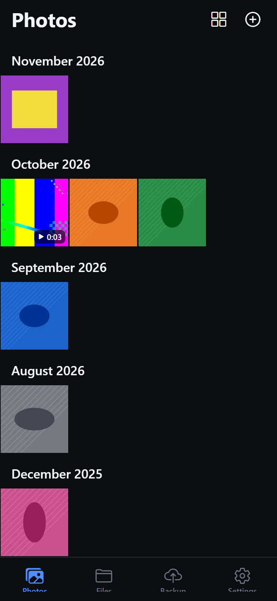
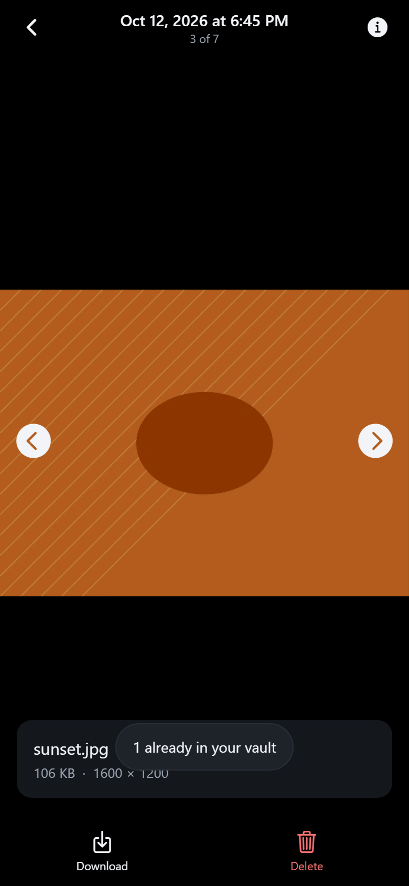
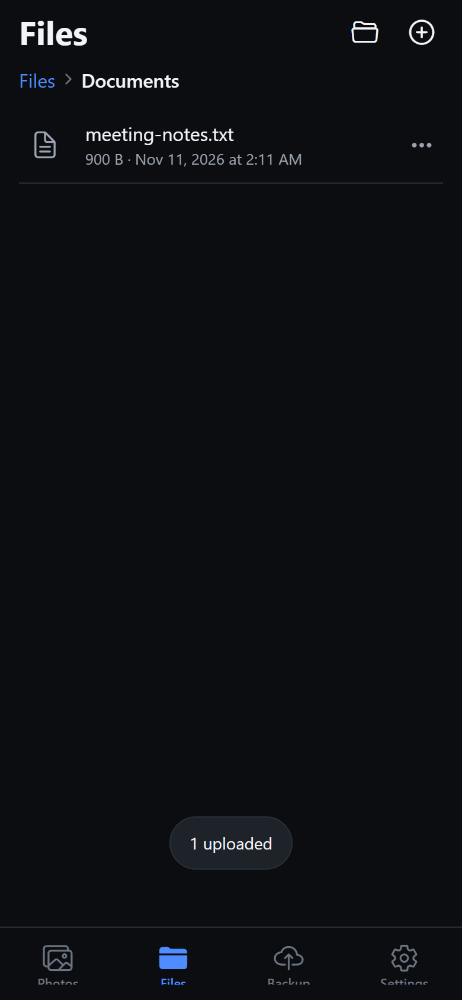
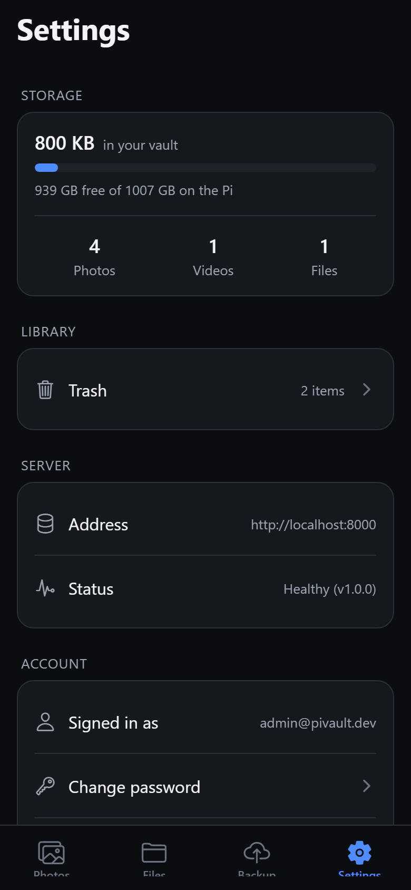
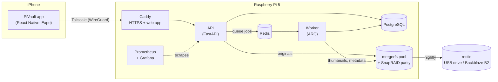

# PiVault

A self-hosted cloud for photos, videos and files. It runs on a Raspberry Pi 5 at home
and comes with its own iPhone app that backs up the camera roll and lets you browse,
upload and download anything from anywhere over Tailscale. No router ports are opened.

Everything here is written for this project: a FastAPI backend, a background worker,
a React Native (Expo) app, and the infrastructure code that turns a blank SD card into
a working server.

| Photos | Viewer | Files | Settings |
| --- | --- | --- | --- |
|  |  |  |  |

## What it does

- **Camera-roll backup** from iPhone. Runs every time the app opens, uploads as iOS
  background transfers, and skips anything already on the server.
- **Photo timeline** grouped by month, with thumbnails, a full-screen viewer, pinch to
  zoom and video playback with seeking.
- **Files**: upload any file, organise it in folders, rename, move, download, share.
- **Trash**: deleted items are kept for 30 days and can be restored.
- **Duplicates are stored once** (SHA-256 of the content).
- **Access from anywhere** over Tailscale, with HTTPS, and nothing exposed to the internet.
- **Storage that survives a dead drive**: mergerfs pool + SnapRAID parity.
- **Nightly encrypted backups** with restic, and a monthly automated restore test.
- **Monitoring**: Prometheus and a Grafana dashboard (uploads, storage, backups, Pi temperature).
- **A web version** of the same app, served by the Pi.

## How it fits together



The API only accepts and serves bytes. Thumbnails, previews and metadata are made by a
separate worker, so uploads stay fast on the Pi. Videos are not transcoded: iPhones play
their own files, and the original is streamed with HTTP Range requests.

## Repository layout

```
backend/            FastAPI app, ARQ worker, Alembic migration, tests, Dockerfile
mobile/             Expo app (TypeScript) and Playwright end-to-end tests
deploy/             Docker Compose (dev, test, production), Caddyfile, Prometheus, Grafana
infra/ansible/      Provisions the Pi: Docker, Tailscale, storage, firewall, timers
infra/image/        Builds the ready-to-flash SD-card image
scripts/            Backups, restore test, disk setup, smoke test
.github/workflows/  CI, end-to-end tests, release images, iOS build
docs/               Setup guides
```

## Quick start on your PC

You need Docker Desktop and Node.js 22+.

```bash
# 1. Start the server (API, worker, PostgreSQL, Redis)
docker compose -f deploy/docker-compose.dev.yml up -d --build

# 2. Check it end to end
bash scripts/smoke-test.sh

# 3. Run the app
cd mobile
npm install
npx expo start        # press w for the web version, or scan the QR code with Expo Go
```

Log in with server `http://localhost:8000` (or `http://<your PC's IP>:8000` from the
phone), email `admin@pivault.dev`, password `pivault-dev-pass`. API docs are at
<http://localhost:8000/docs>.

## Putting it on the Pi

1. Build the SD-card image: `infra/image/build.sh` (or `build.ps1` in PowerShell).
2. Write `infra/image/build/pivault-rpi5-arm64.img.xz` to the SD card with Raspberry Pi Imager.
3. Boot the Pi. It sets itself up in 20 to 30 minutes.

The full walkthrough, including Tailscale, the SSDs and backups, is in
[docs/SETUP.md](docs/SETUP.md). The iPhone app is covered in [docs/APP.md](docs/APP.md),
and day-to-day care in [docs/OPERATIONS.md](docs/OPERATIONS.md).

## Tests

| What | How to run | Covers |
| --- | --- | --- |
| Backend (45 tests) | `docker compose -f deploy/docker-compose.test.yml run --rm --build tests` | API, auth, uploads, dedup, thumbnails (JPEG, HEIC, video), Range requests, trash, folders, against real PostgreSQL |
| Server smoke test | `bash scripts/smoke-test.sh` | Upload through the real Redis queue and worker |
| App end to end (17 tests) | `cd mobile && npm run build:web && npm run test:e2e` | The real app in a browser against the real server |
| App static checks | `cd mobile && npm run typecheck && npm run lint` | TypeScript and ESLint |
| Provisioning | `bash infra/ansible/test/run.sh` | The whole Ansible playbook in a disposable Debian 13 machine |

What automated tests cannot cover is listed honestly in
[docs/APP.md](docs/APP.md#what-has-and-has-not-been-tested).

## API

Every endpoint is under `/api`, takes a Bearer token (except login, refresh and health)
and is documented at `/docs`.

| Method | Path | What it does |
| --- | --- | --- |
| POST | `/api/auth/login` | Email + password → access and refresh tokens |
| POST | `/api/auth/refresh` | Swap a refresh token for a new pair |
| POST | `/api/auth/logout` | End a session |
| GET | `/api/me` | Current user |
| POST | `/api/me/password` | Change password |
| POST, GET | `/api/devices` | Register or list devices that back up |
| POST | `/api/assets/check` | Camera-roll ids → the ones the server is missing |
| POST | `/api/assets` | Upload (multipart or raw body), deduplicated by SHA-256 |
| GET | `/api/assets` | Timeline, newest first; filters `kind`, `folder_id`, `trashed`, `q`; cursor pagination |
| GET | `/api/assets/months` | Photo counts per month |
| GET, PATCH, DELETE | `/api/assets/{id}` | Metadata; rename or move; move to trash (or `?permanent=true`) |
| GET | `/api/assets/{id}/thumbnail` | WebP thumbnail or preview |
| GET | `/api/assets/{id}/original` | Original file, with Range support |
| POST | `/api/assets/{id}/restore` | Restore from trash |
| GET, POST | `/api/folders` | List or create folders |
| GET, PATCH, DELETE | `/api/folders/{id}` | Read, rename, move or delete a folder |
| GET | `/api/stats` | Counts, bytes used, disk free |
| GET | `/api/health` | Liveness |
| GET | `/metrics` | Prometheus metrics (not exposed outside Docker) |

## Design notes

- **Dedup and idempotent backup.** `(owner, sha256)` is unique, so identical content is
  stored once. A separate `device_assets` table maps each camera-roll item to its stored
  asset, so several identical photos on the phone all count as backed up.
- **Keyset pagination** on `(taken_at, id)` keeps the timeline fast however large it grows.
- **Auth.** Argon2 password hashes, 15-minute JWT access tokens, 30-day refresh tokens
  that rotate on use. Reusing an old refresh token ends every session; a retry within
  two minutes is tolerated, because phones lose responses.
- **Paths are generated by the server** from ids and dates. A crafted filename is only
  ever a display name.
- **Fail closed on storage.** If a drive drops out, its mount point is locked so new
  photos fail loudly instead of quietly landing on the SD card.
- **SnapRAID guard.** The nightly sync is skipped when an unusual number of files has
  vanished, so an accident is not baked into parity.

## Costs

All software is free and open source. The only optional cost is the Apple Developer
Program (US$99 per year), needed to install your own build on an iPhone without a Mac.
The free Expo Go app covers everything except background backup.
